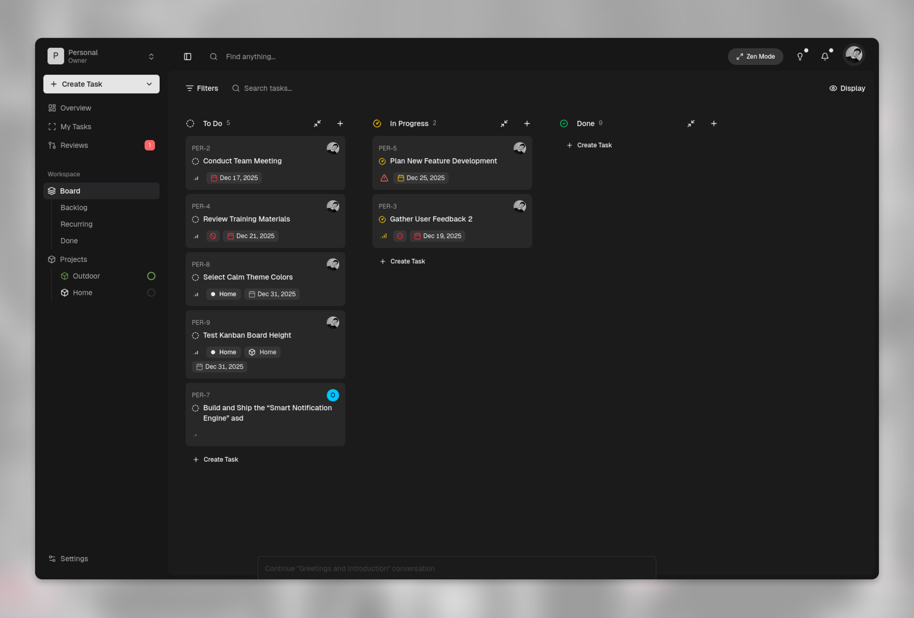

<h1 align="center"><b>Mimir</b></h1>

<p align="center">An open-source, AI-assisted task management app you can fork and self-host.<br/><a href="https://tasks.mimrai.com">tasks.mimrai.com</a> · by <a href="https://mimrai.com">MIMRAI</a></p>

> Mimir started as a product and is no longer run as a hosted service. The full codebase is published as a template: use it as a starting point for your own tool, self-host it for your team, or take the parts you need. Click **Use this template** on GitHub to start your own copy.

## Architecture

- Monorepo managed with [Turborepo](https://turborepo.com/)
- Typescript
- Bun
- React
- Next.js
- Supabase
- Tailwind CSS
- Shadcn UI

## Hosting

- Supabase (database, storage, realtime)
- Vercel (website, dashboard)
- Fly.io (api)

## Services

- Trigger.dev (background jobs)
- Resend (email delivery)
- Github Actions (ci/cd)
- Upstash (redis caching)
- Sentry (error tracking)
- OpenPanel.dev (events and analytics)
- OpenAI (ai features)

## Landing page

The landing page in `apps/website` is a static Next.js export served by a Cloudflare Worker, `mimrai-tasks`, at [tasks.mimrai.com](https://tasks.mimrai.com). Its settings live in `apps/website/wrangler.jsonc`.

```sh
cd apps/website
bunx wrangler login   # once
bun run deploy        # next build && wrangler deploy
```

## Repo Activity


## License

This project is licensed under the **[AGPL-3.0](https://opensource.org/licenses/AGPL-3.0)** for non-commercial use.

### Commercial Use

For commercial use or deployments requiring a setup fee, please contact us
for a commercial license at [founders@mimrai.com](mailto:founders@mimrai.com).

By using this software, you agree to the terms of the license.
